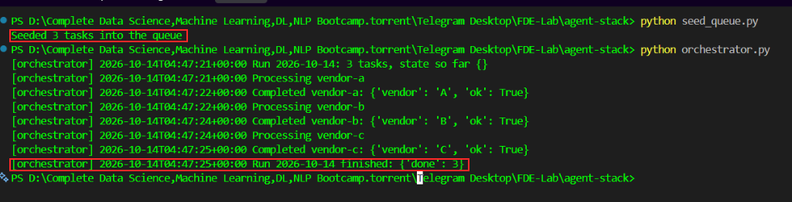
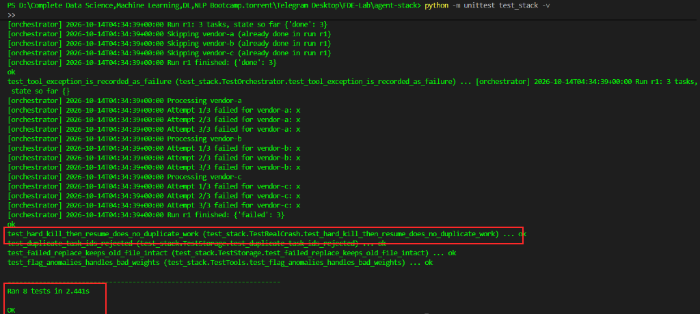
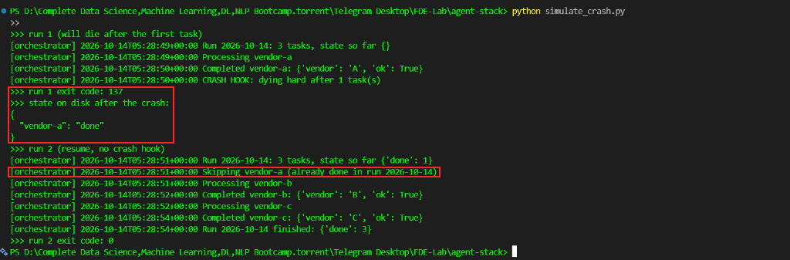
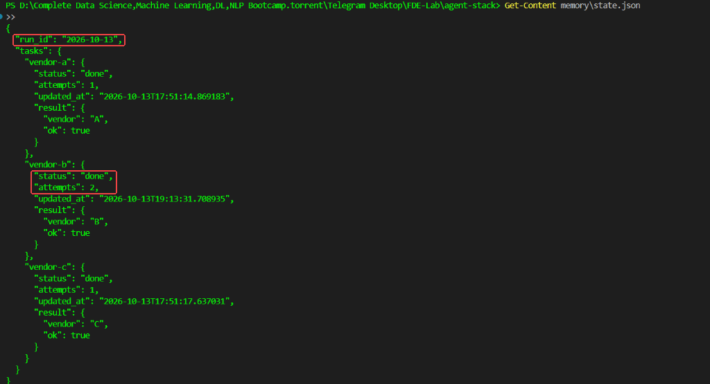

## Introduction

A logistics automation startup runs a nightly job that pulls shipment manifests from several vendor APIs, cross-references them, flags anomalies, and files a report. A single long agent run keeps failing the same way: it forgets what it decided twenty steps ago, reprocesses vendors it already handled, and when it crashes at step 40 there's no way to resume. The whole thing restarts from zero.

What looks like an intelligence problem is an architecture problem. The agent has no memory it can trust, no queue to pace its work, and no separation between the thing that *decides* and the things that *do*. The fix is to stop running one monolithic agent and instead compose four small components, each with a single job: an orchestrator that decides what happens next, tools that execute, a memory layer that survives restarts, and a queue that feeds work in at a controlled pace.

By the end you'll have a working agent stack where any component can crash and the system picks up where it left off, because the state lives outside the agent, not inside it.


> **Where the code lives in this repo:** the finished Lab 3 code is in `lab3-agent-stack/`. The `agent-stack/` folder was upgraded in Lab 4 (its `tools.py` became an HTTP client), so Lab 3's tests and crash demo do **not** run from `agent-stack/`. Run every Lab 3 command from `lab3-agent-stack/`.

---

## The workspace layout

Before writing a single file, understand the shape of what you're building. The whole system is a handful of small Python modules plus two directories that hold state on disk. Nothing hides inside a framework; every moving part is visible.

```
lab3-agent-stack/
├── memory/              # state that survives restarts
│   ├── state.json       # (created at runtime) run-scoped task statuses
│   ├── queue.json       # (created at runtime) the work list
│   └── history/         # (created at runtime) previous runs, archived
├── logs/                # orchestrator decision log
│   └── run.log          # (created at runtime)
├── storage.py           # atomic JSON writes (temp file + fsync + os.replace)
├── memory.py            # run-scoped, per-task state machine
├── tools.py             # isolated tool functions
├── job_queue.py         # queue read/write (named job_queue to avoid stdlib collision)
├── seed_queue.py        # one-off script to fill the queue
├── orchestrator.py      # the decision-maker that ties it together
├── simulate_crash.py    # proves crash recovery works (real hard kill)
├── test_stack.py        # 8 automated tests
└── requirements.txt     # requests==2.32.3
```

> **Why `job_queue.py` and not `queue.py`?**
> Python has a built-in standard library module named `queue`. Third-party libraries like `requests` (via `urllib3`) import Python's standard `queue`. If you name your file `queue.py`, Python imports your local file instead of the standard library, crashing immediately with an `AttributeError`. Naming this module `job_queue.py` prevents namespace collisions.

The `.json` and `.log` files inside `memory/` and `logs/` are not created by hand. They appear when the system runs. Everything else you create in the steps below, in this order, because each file depends only on the ones before it.

---

## Chapter 1 — Confirm your environment and scaffold the directories

The stack is plain Python. Confirm what you need, then lay down the two directories that will hold state.

```bash
python3 --version
pip3 install --break-system-packages requests==2.32.3
```

You need Python 3.9 or newer. The only external dependency is `requests`, used by the one tool that calls a vendor API. Everything else uses the standard library on purpose, so the moving parts stay visible.

```bash
mkdir -p lab3-agent-stack/{memory,logs} && cd lab3-agent-stack
```

`memory/` is where state persists between runs. `logs/` is where the orchestrator narrates its decisions. Keeping them on disk, not in the process, is the whole point of what follows.

---

## Chapter 2 — Build the memory layer first (Atomic & Run-Scoped)

Most people build the orchestrator first and bolt memory on later. That's backwards. The memory layer defines what the agent is *allowed to forget*, so it comes first. If state lives only in the running process, a crash erases everything. Put it on disk and a crash becomes a pause.

In production, two critical bugs frequently kill naive state storage:
1. **Mid-write Corruption:** Calling `open(file, "w")` truncates the file immediately. If the server crashes or loses power while writing, the JSON is destroyed. We solve this by writing to a temporary file, flushing with `fsync`, and atomically replacing via `os.replace`.
2. **Permanent Nightly Lockout:** If `processed` is a permanent flat list, night 2's run will skip every single vendor because it thinks they were done on night 1. We solve this by scoping state to a `run_id` (default: today's UTC date). A new `run_id` starts clean and the previous run is archived to `memory/history/`.

### 2.1 Atomic file helper — `lab3-agent-stack/storage.py`

Every file the stack writes goes through this one helper, so there is exactly one place that has to get atomicity right. Lab 4 reuses it unchanged.

```python
"""Small helpers for durable JSON files.

Writes are atomic: data goes to a temp file, is fsynced, then os.replace()
swaps it in. A crash at any moment leaves either the old file or the new
file, never a half-written one.
"""
import json
import os


def data_dir():
    return os.environ.get("AGENT_DATA_DIR", "memory")


def log_dir():
    return os.environ.get("AGENT_LOG_DIR", "logs")


def atomic_write_json(path, obj):
    os.makedirs(os.path.dirname(path) or ".", exist_ok=True)
    tmp = f"{path}.tmp"
    with open(tmp, "w") as f:
        json.dump(obj, f, indent=2)
        f.flush()
        os.fsync(f.fileno())
    os.replace(tmp, path)


def read_json(path, default):
    try:
        with open(path) as f:
            return json.load(f)
    except FileNotFoundError:
        return default
    except json.JSONDecodeError as e:
        raise RuntimeError(
            f"{path} is corrupt ({e}). Inspect it before deleting anything."
        ) from e
```

### 2.2 Run-scoped memory — `lab3-agent-stack/memory.py`

Each task has a `status` (`running` / `done` / `failed`) and an `attempts` counter. Only `done` tasks are skipped on resume, and every transition is written to disk immediately.

```python
"""Memory layer: durable, run-scoped, per-task state.

State shape:
{
  "run_id": "2026-10-14",
  "tasks": {
    "vendor-a": {"status": "done", "attempts": 1, "result": {...},
                 "updated_at": "..."}
  }
}

status is one of: running | done | failed.
Only "done" tasks are skipped on resume. A new run_id starts clean
(the previous run is archived under memory/history/).
"""
import os
from datetime import datetime, timezone

import storage


def _state_path():
    return os.path.join(storage.data_dir(), "state.json")


def _now():
    return datetime.now(timezone.utc).isoformat(timespec="seconds")


def load(run_id):
    old = storage.read_json(_state_path(), None)
    if old and old.get("run_id") == run_id:
        return old
    if old and old.get("run_id"):
        archive = os.path.join(storage.data_dir(), "history", f"{old['run_id']}.json")
        storage.atomic_write_json(archive, old)
    return {"run_id": run_id, "tasks": {}}


def save(state):
    storage.atomic_write_json(_state_path(), state)


def get(state, task_id):
    return state["tasks"].get(task_id, {})


def record(state, task_id, status, result=None, error=None):
    """Update one task and persist immediately (one write per transition)."""
    entry = state["tasks"].setdefault(task_id, {"attempts": 0})
    if status == "running":
        entry["attempts"] += 1  # counted before executing, so a crash still counts
    entry["status"] = status
    entry["updated_at"] = _now()
    if result is not None:
        entry["result"] = result
    if error is not None:
        entry["error"] = error
    elif status == "done":
        entry.pop("error", None)
    save(state)


def summary(state):
    counts = {}
    for entry in state["tasks"].values():
        counts[entry.get("status", "?")] = counts.get(entry.get("status", "?"), 0) + 1
    return counts
```

---

## Chapter 3 — Build the tools as isolated functions

Tools are the hands of the system. Each one does exactly one thing, takes simple input, returns simple output, and, critically, knows nothing about memory, the queue, or the orchestrator. That isolation is what lets you test a tool alone, swap it, or run it with the network cut off without dragging the rest of the system along.

Create `lab3-agent-stack/tools.py`:

```python
"""Tools: plain functions. They know nothing about memory, queue or orchestrator."""
import csv
import io
import os

import requests


def parse_manifest(csv_text):
    """Turn raw CSV text into a list of shipment rows."""
    return list(csv.DictReader(io.StringIO(csv_text)))


def _weight_is_anomalous(value):
    if value is None or str(value).strip() == "":
        return True
    try:
        return float(value) == 0
    except ValueError:
        return True  # non-numeric weight is itself an anomaly, not a crash


def flag_anomalies(rows):
    """Rows whose declared weight is missing, zero or not a number."""
    return [row for row in rows if _weight_is_anomalous(row.get("weight"))]


def fetch_vendor_status(vendor_id):
    """Call the vendor API. Reports failure honestly: ok=False plus an error."""
    url = os.environ.get("VENDOR_API_URL", "https://httpbin.org/get")
    try:
        resp = requests.get(url, params={"vendor": vendor_id}, timeout=5)
    except requests.RequestException as e:
        return {"vendor": vendor_id, "ok": False, "error": str(e)}
    if resp.status_code != 200:
        return {"vendor": vendor_id, "ok": False, "error": f"HTTP {resp.status_code}"}
    return {"vendor": vendor_id, "ok": True}
```

Notice each function is pure input-to-output. `flag_anomalies` doesn't write to disk, and a non-numeric weight is reported as an anomaly instead of crashing the run. `fetch_vendor_status` doesn't decide what to do with a failure, it just reports one honestly (`ok: False` plus the error). Decisions belong to the orchestrator, not the tools.

> `VENDOR_API_URL` defaults to `https://httpbin.org/get`, a public demo service that sometimes answers 502/503. If that happens the task is correctly recorded as `failed` and retried; point `VENDOR_API_URL` at any URL that returns HTTP 200 if you need a stable demo.

---

## Chapter 4 — Build the queue and seed it

The queue is a list of work waiting to happen, held outside the agent. With a queue, work is explicit and ordered. It is written with the same atomic helper, and duplicate task ids are rejected.

Create `lab3-agent-stack/job_queue.py`:

```python
"""Queue: the ordered work list, stored on disk.

Named job_queue.py (not queue.py) so it does not shadow Python's stdlib
`queue` module, which requests/urllib3 import.
"""
import os

import storage


def _path():
    return os.path.join(storage.data_dir(), "queue.json")


def seed(tasks):
    ids = [t["id"] for t in tasks]
    if len(ids) != len(set(ids)):
        raise ValueError("duplicate task ids in queue")
    storage.atomic_write_json(_path(), tasks)


def load():
    return storage.read_json(_path(), [])
```

Now create the one-off seeding script at `lab3-agent-stack/seed_queue.py`:

```python
import job_queue

tasks = [
    {"id": "vendor-a", "type": "status", "vendor_id": "A"},
    {"id": "vendor-b", "type": "status", "vendor_id": "B"},
    {"id": "vendor-c", "type": "status", "vendor_id": "C"},
]
job_queue.seed(tasks)
print(f"Seeded {len(tasks)} tasks into the queue")
```

Run it:

```bash
python3 seed_queue.py
```

The queue lives in `memory/queue.json`, on disk, not in a volatile variable.

---

## Chapter 5 — Wire the orchestrator together (With Retries & Checkpointing)

The orchestrator pulls tasks from the queue, skips tasks already `done` in this run, executes tools, retries failures with exponential backoff, and **persists state immediately after every transition**.

> **Critical Rule:** If a vendor call fails (`ok: False`), do NOT mark it done! Failed calls record the error, respect a retry ceiling (`MAX_ATTEMPTS`, default 3), and only become `done` on genuine success. A task that is still `failed` is tried again on the next run.

Create `lab3-agent-stack/orchestrator.py`:

```python
"""Orchestrator: the only component that talks to all the others.

Holds no state of its own. Every transition is written to disk, so a kill at
any instant can be resumed by simply running it again.

Delivery semantics: at-least-once. If the process dies after a tool ran but
before "done" was saved, that task runs again on resume. Tools should be
idempotent (fetching a status is).
"""
import os
import sys
import time
from datetime import datetime, timezone

import job_queue
import memory
import storage
import tools


def _max_attempts():
    return int(os.environ.get("MAX_ATTEMPTS", "3"))


def _backoff():
    return float(os.environ.get("RETRY_BACKOFF", "0.5"))


def log(msg):
    line = f"{datetime.now(timezone.utc).isoformat(timespec='seconds')} {msg}"
    print(f"[orchestrator] {line}", flush=True)
    os.makedirs(storage.log_dir(), exist_ok=True)
    with open(os.path.join(storage.log_dir(), "run.log"), "a") as f:
        f.write(line + "\n")


def execute(task):
    if task["type"] == "status":
        return tools.fetch_vendor_status(task["vendor_id"])
    raise ValueError(f"unknown task type: {task['type']}")


def process(state, task):
    """Run one task with retries. Returns True only if it really succeeded."""
    tid = task["id"]
    attempts = _max_attempts()
    for attempt in range(1, attempts + 1):
        memory.record(state, tid, "running")
        result, error = None, None
        try:
            result = execute(task)
            if isinstance(result, dict) and result.get("ok") is True:
                memory.record(state, tid, "done", result=result)
                log(f"Completed {tid}: {result}")
                return True
            error = (result or {}).get("error", "tool reported failure")
        except Exception as e:  # tool crashed or unknown task type
            error = str(e)
        memory.record(state, tid, "failed", result=result, error=error)
        log(f"Attempt {attempt}/{attempts} failed for {tid}: {error}")
        if attempt < attempts:
            time.sleep(_backoff() * 2 ** (attempt - 1))
    return False


def run(run_id=None):
    run_id = (
        run_id
        or os.environ.get("RUN_ID")
        or datetime.now(timezone.utc).strftime("%Y-%m-%d")
    )
    tasks = job_queue.load()
    state = memory.load(run_id)
    crash_after = int(os.environ.get("CRASH_AFTER", "0"))  # test hook
    log(f"Run {run_id}: {len(tasks)} tasks, state so far {memory.summary(state)}")

    handled = 0
    for task in tasks:
        tid = task["id"]
        if memory.get(state, tid).get("status") == "done":
            log(f"Skipping {tid} (already done in run {run_id})")
            continue
        log(f"Processing {tid}")
        process(state, task)
        handled += 1
        if crash_after and handled >= crash_after:
            log(f"CRASH HOOK: dying hard after {handled} task(s)")
            os._exit(137)  # no cleanup, like kill -9

    summary = memory.summary(state)
    log(f"Run {run_id} finished: {summary}")
    return 0 if summary.get("done", 0) == len(tasks) else 1


if __name__ == "__main__":
    sys.exit(run())
```

`CRASH_AFTER` is a test hook used by the crash demo in Chapter 7: after N tasks the process kills itself with `os._exit(137)`, the same as `kill -9`, with no cleanup.

Run it:

```bash
python3 orchestrator.py
echo $?        # 0 = every task done, 1 = some task still failed
```



---

## Chapter 6 — Automated Test Suite & Resiliency Verification

Before testing crash recovery in live workflows, run the automated test suite `test_stack.py` (8 tests; the file is in `lab3-agent-stack/test_stack.py`). It needs no internet: vendor calls are mocked or served by a local HTTP server. It verifies resume without duplicate work, a new `run_id` starting fresh, failed tasks not being marked done, atomic writes surviving a failed replace, duplicate queue ids being rejected, bad weights, and a real process hard-kill followed by a resume:

```bash
python3 -m unittest test_stack -v
```

All 8 architectural tests pass, confirming zero state loss or duplicated execution:



---

## Chapter 7 — Prove the system survives a real crash

Simulate a real process crash during execution with the `CRASH_AFTER=1` hook. The process dies hard via `os._exit(137)` (equivalent to `SIGKILL` / `kill -9`), leaving state safely saved on disk. When rerun, completed tasks are skipped while remaining tasks resume.

The demo uses its own fresh `RUN_ID` (`crash-demo-<timestamp>`). Without that, running it after Chapter 5 would skip every task (today's run is already done), never reach the crash, and exit 0, proving nothing.

Create `lab3-agent-stack/simulate_crash.py`:

```python
"""Real crash simulation: the orchestrator process dies hard after 1 task,
then is started again. No editing of state files by hand.

Uses its own fresh RUN_ID, so it demonstrates the crash even if today's
normal run (python3 orchestrator.py) has already finished every task.
"""
import json
import os
import subprocess
import sys
import time

import storage

run_id = os.environ.get("RUN_ID") or f"crash-demo-{int(time.time())}"
env = dict(os.environ, RUN_ID=run_id, CRASH_AFTER="1")
print(f">>> run 1 of '{run_id}' (will die after the first task)")
code = subprocess.run([sys.executable, "orchestrator.py"], env=env).returncode
print(f">>> run 1 exit code: {code}")

with open(os.path.join(storage.data_dir(), "state.json")) as f:
    state = json.load(f)
print(">>> state on disk after the crash:")
print(json.dumps({k: v["status"] for k, v in state["tasks"].items()}, indent=2))

print(">>> run 2 (resume, no crash hook)")
env.pop("CRASH_AFTER")
code = subprocess.run([sys.executable, "orchestrator.py"], env=env).returncode
print(f">>> run 2 exit code: {code}")
```

Run the real crash simulation:

```bash
python3 simulate_crash.py
```

Notice: Run 1 dies hard after `vendor-a` with `exit code: 137`. The state on disk preserves `vendor-a: done`. On run 2, the orchestrator resumes, skips `vendor-a` (`already done in run ...`), completes `vendor-b` and `vendor-c`, and exits with code `0`:



---

## Chapter 8 — Clean up & State Inspection

Between test runs, inspect the final persisted atomic state:

```bash
cat memory/state.json
ls memory/history/
```

`state.json` holds the latest run (the `crash-demo-...` run from Chapter 7) with every vendor `"done"`. The earlier run from Chapter 5 was archived to `memory/history/<run_id>.json` instead of being overwritten:



To reset before another clean run:

```bash
rm -rf memory/state.json memory/queue.json memory/history logs/run.log memory/*.tmp
```

---

## Known limits

- **At-least-once:** if the process dies after a tool ran but before `done` was saved, that task runs again on resume. Tools must be idempotent (fetching a status is).
- **One orchestrator at a time:** two orchestrators on the same `state.json` would overwrite each other's updates. Add a file lock before running them in parallel.
- **No LLM yet:** decisions are `if task["type"] == "status"`. Lab 5's capstone adds a local model.

---

## End of day — Team Review

> *"So what happens when the 3 AM run crashes halfway?"*
> *"Because we write atomically after every single task and save to a scoped `run_id`, it resumes right from where it crashed. It retries failed tasks up to 3 times, never repeats finished tasks, and tomorrow night's job starts with a fresh batch automatically."*
