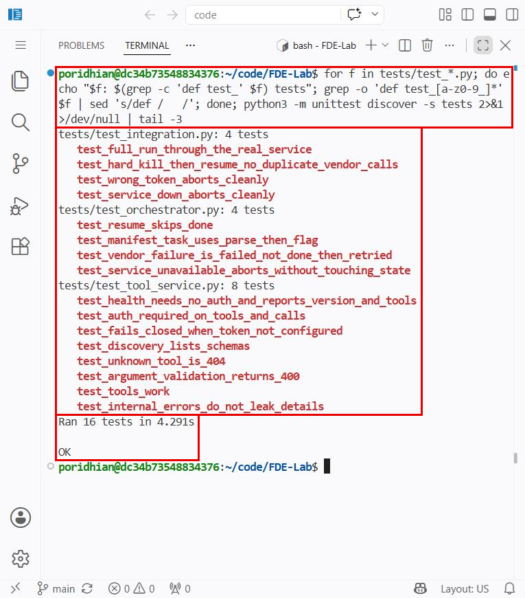
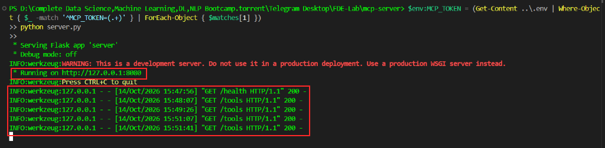
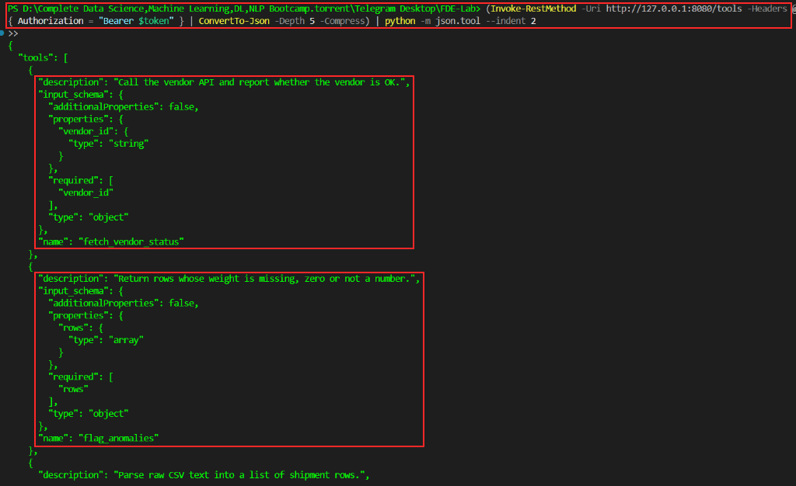
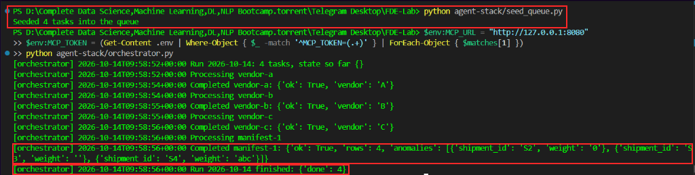
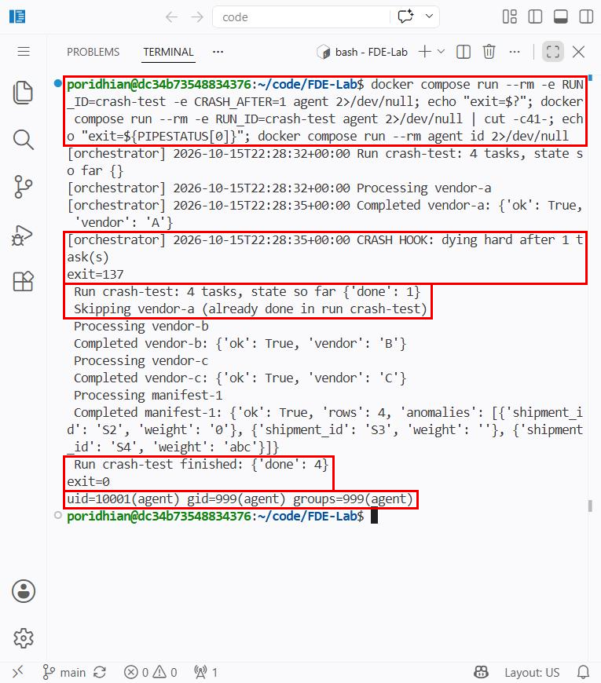

## Introduction

It's been three weeks since you finished L3. The four-piece agent stack — orchestrator, tools, memory, queue — is now running every night at Threadline Logistics, the logistics automation startup you've been embedded with. Asha, the head of platform, has just hired three new backend engineers to expand the team, and the cracks are starting to show.

Each of the new hires cloned the `agent-stack/` repo onto their laptop, ran `pip install requests`, and started the orchestrator locally. The tool module you wrote together — the one that talks to Threadline's vendor APIs and surfaces `fetch_vendor_status` and `parse_manifest` as tools — runs as a Python module inside the orchestrator process. Every laptop has its own copy of that module. Last week one of the new hires shipped a fix to `flag_anomalies` and forgot to push the change. Two days of nightly runs ran on stale anomaly logic before anyone noticed.

You get a Slack message from Asha:

> *"Pull the tools out of the orchestrator process. Make them a service. I want one image the whole team pulls, not five laptops with five copies of the code."*

What looks like a simple packaging exercise is actually the moment the agent platform stops being a personal script and becomes team infrastructure. The tools become a network service. The orchestrator becomes a client. The whole system runs in Docker so it behaves identically on Asha's laptop, the new hires' machines, and the CI server running the nightly cron job.


By the end of this lab you'll have:
- A standardized **Tool Service** (MCP-style HTTP architecture) providing discovery (`GET /tools`), schema validation, and execution (`POST /tools/<name>`),
- **Zero-Trust Security & Hardening**: Bearer token authentication (`MCP_TOKEN`), Gunicorn WSGI server, non-root users (`uid 10001`), read-only root filesystems, and dropped Linux capabilities,
- A **Dynamic Tool Dispatcher** in the orchestrator that discovers schemas automatically and eliminates interface coupling and wrapper boilerplate,
- **Preflight Readiness & Fail-Safe Abort**: Orchestrator preflight verification that ensures tools are available before touching state, exiting with status code 2 to avoid burning retry attempts,
- **Continuous Atomic State Checkpointing**: Per-task durable state updates surviving hard process termination (`exit code 137`),
- **Production Container Lifecycle**: One-shot worker containers (`docker compose run --rm agent`) with explicit exit codes, backed by Docker named volumes (`agent_data:/data`) for persistent state,
- A **16-Test Automated Suite**: Validating tool schemas, token auth, fail-closed behavior, input validation, orchestrator retries, and OS-level crash recovery over real HTTP.

---

## The workspace layout

You are building directly on top of the resilient components designed in L3 (`storage.py`, `memory.py`, `job_queue.py`, copied unchanged from `lab3-agent-stack/`). In this repo the L4 version lives in `agent-stack/`; the L3 version stays in `lab3-agent-stack/` so both labs keep working. Here is the complete architecture layout:

```
agent-stack/                          # Orchestrator client & local durability
├── memory/                           # State directory (local fallback)
│   ├── state.json                    # Run-scoped atomic checkpoint file
│   └── queue.json                    # Ordered work list
├── logs/                             # Orchestrator audit log
│   └── run.log                       # Decision and execution log
├── storage.py                        # Atomic file write helper (fsync + os.replace)
├── memory.py                         # Durable, run-scoped, per-task state machine
├── job_queue.py                      # Queue manager (avoids stdlib collision)
├── seed_queue.py                     # Seeds status & manifest tasks
├── tools.py                          # DYNAMIC HTTP DISPATCHER & preflight readiness
├── orchestrator.py                   # Orchestrator with preflight check & retries
└── requirements.txt                  # requests==2.32.3

mcp-server/                           # The Tool Service (MCP-Style)
├── .dockerignore                     # Docker build exclusion rules
├── Dockerfile                        # Hardened Python 3.11 image + Gunicorn + HEALTHCHECK
├── requirements.txt                  # flask==3.0.3, requests==2.32.3, gunicorn==22.0.0
├── server.py                         # Discovery, JSON schemas, Bearer auth, invoke
└── tools_impl.py                     # Pure tool implementations (parse, flag, fetch)

agent-image/                          # Dockerfile for orchestrator container
└── Dockerfile                        # Non-root user + volume mount point (/data)

tests/                                # 16 automated resiliency & unit tests
├── _paths.py                         # Sys.path configuration
├── test_tool_service.py              # Schema discovery, auth, validation, error masking
├── test_orchestrator.py              # State machine, retries, resume, preflight check
└── test_integration.py               # Real HTTP servers + OS process hard-kill crash tests

docker-compose.yml                    # Multi-container orchestration with security profiles
docker-compose.debug.yml              # Optional: publish mcp-server on 127.0.0.1:8080 for curl / Lab 5 capstone
.env.example                          # Environment variable template (MCP_TOKEN, APP_VERSION)
.dockerignore                         # Global Docker build exclusion rules
```

---

## Chapter 1 — Environment Prerequisites & Configuration

Confirm your Docker environment and Python installation:

```bash
docker --version
docker compose version
python3 --version
```

### 1.1 Configure Environment Secrets (`.env`)
In production, internal microservices must not be left unauthenticated. We use Bearer token authentication to enforce zero trust between the orchestrator and the tool service.

Copy the template and generate a cryptographically strong secret token:

```bash
cp .env.example .env
```

Generate and assign a secure token:

```bash
python3 -c "import secrets; print(secrets.token_urlsafe(32))"
```

Update your `.env` file with the generated token:

```env
MCP_TOKEN=your_generated_secret_token_here
APP_VERSION=0.2.0
```

One-liner for Linux (Poridhi VS Code terminal) that does both steps:

```bash
printf 'MCP_TOKEN=%s\nAPP_VERSION=0.2.0\n' "$(python3 -c 'import secrets; print(secrets.token_urlsafe(32))')" > .env
```

Optional: `VENDOR_API_URL` (default `https://httpbin.org/get`) is the vendor API the `fetch_vendor_status` tool calls. httpbin.org is a public demo service that sometimes answers 502/503; set `VENDOR_API_URL=<any URL that returns 200>` in `.env` if it is flaky.

> [!IMPORTANT]
> The `.env` file contains runtime secrets and is listed in `.gitignore`. Never commit `.env` into source control.

---

## Chapter 2 — The MCP Tool Service Contract

In L3, `orchestrator.py` imported tools directly (`import tools`). In production, this creates **Interface Coupling & Drift**: whenever a developer modifies a tool or adds new parameters, every consumer's wrapper code breaks or requires manual synchronization.

A true tool service decouples tool evolution from orchestrator logic through a two-part contract:
1. **Liveness & Version (`GET /health`):** Unauthenticated endpoint for Docker and Kubernetes readiness probes, reporting the service version and available tool names.
2. **Discovery (`GET /tools`):** Authenticated endpoint returning all available tools, their descriptions, and strict JSON Schemas for input parameters.
3. **Execution (`POST /tools/<name>`):** Authenticated endpoint accepting a JSON object of arguments, validating the payload against the tool's schema, executing the tool, and returning the result or a sanitized error.

```
       Discovery (GET /tools)
Orchestrator --------------> Tool Service (Returns JSON Schemas)
             <--------------
       Execution (POST /tools/<name>)
             --------------> Tool Service (Validates inputs & executes)
             <-------------- (Returns JSON result)
```

> [!NOTE]
> **MCP-Style HTTP vs Official MCP SDK:**
> This lab implements an MCP-style HTTP architecture (discovery + JSON Schema + execution). While production systems may choose the official Anthropic Model Context Protocol SDK over SSE/Stdio transports, the architectural principles of schema discovery, dynamic dispatch, and interface decoupling are identical.

---

## Chapter 3 — Build the Pure Tool Implementations

Move all business tool logic out of the orchestrator into `mcp-server/tools_impl.py`. These functions are pure business logic; they have no HTTP routing or authentication dependencies:

`mcp-server/tools_impl.py`:

```python
"""Tool implementations (the only place tool logic lives)."""
import csv
import io
import os

import requests


def parse_manifest(csv_text):
    """Tool: turn raw CSV text into a list of shipment rows."""
    return list(csv.DictReader(io.StringIO(csv_text)))


def _weight_is_anomalous(value):
    if value is None or str(value).strip() == "":
        return True
    try:
        return float(value) == 0
    except ValueError:
        return True


def flag_anomalies(rows):
    """Tool: return rows where declared weight is missing, zero, or non-numeric."""
    return [row for row in rows if _weight_is_anomalous(row.get("weight"))]


def fetch_vendor_status(vendor_id):
    """Tool: query external vendor status API."""
    url = os.environ.get("VENDOR_API_URL", "https://httpbin.org/get")
    try:
        resp = requests.get(url, params={"vendor": vendor_id}, timeout=5)
    except requests.RequestException as e:
        return {"vendor": vendor_id, "ok": False, "error": str(e)}
    if resp.status_code != 200:
        return {"vendor": vendor_id, "ok": False, "error": f"HTTP {resp.status_code}"}
    return {"vendor": vendor_id, "ok": True}
```

---

## Chapter 4 — Build the Schema-Aware Tool Service

### 4.1 Dependencies (`mcp-server/requirements.txt`)
We use Gunicorn as the production WSGI server instead of Flask's built-in development server:

```
flask==3.0.3
requests==2.32.3
gunicorn==22.0.0
```

### 4.2 Production Server (`mcp-server/server.py`)
The tool service enforces:
- **Bearer Token Auth:** Constant-time token verification using `hmac.compare_digest` to prevent timing attacks.
- **Fail-Closed Security:** Rejects all traffic with HTTP 503 if no `MCP_TOKEN` is configured.
- **Input Validation:** Verifies required arguments, disallows unexpected properties (`additionalProperties: False`), and validates argument data types.
- **Information Leak Prevention:** Catches execution errors, logs the stack trace to the server log, and returns a sanitized generic error to clients.

`mcp-server/server.py`:

```python
"""Tool service: an MCP-style HTTP service (JSON in, JSON out).

  GET  /health          no auth   liveness + version + tool names
  GET  /tools           auth      discovery: name, description, input schema
  POST /tools/<name>    auth      call a tool with a JSON object of arguments
"""
import hmac
import logging
import os

from flask import Flask, jsonify, request

import tools_impl

app = Flask(__name__)
logging.basicConfig(level=logging.INFO)
log = logging.getLogger("tool-service")

VERSION = os.environ.get("APP_VERSION", "dev")

TOOLS = {
    "parse_manifest": {
        "fn": tools_impl.parse_manifest,
        "description": "Parse raw CSV text into a list of shipment rows.",
        "input_schema": {
            "type": "object",
            "properties": {"csv_text": {"type": "string"}},
            "required": ["csv_text"],
            "additionalProperties": False,
        },
    },
    "flag_anomalies": {
        "fn": tools_impl.flag_anomalies,
        "description": "Return rows whose weight is missing, zero or not a number.",
        "input_schema": {
            "type": "object",
            "properties": {"rows": {"type": "array"}},
            "required": ["rows"],
            "additionalProperties": False,
        },
    },
    "fetch_vendor_status": {
        "fn": tools_impl.fetch_vendor_status,
        "description": "Call the vendor API and report whether the vendor is OK.",
        "input_schema": {
            "type": "object",
            "properties": {"vendor_id": {"type": "string"}},
            "required": ["vendor_id"],
            "additionalProperties": False,
        },
    },
}

_PY_TYPES = {
    "string": str, "array": list, "object": dict,
    "boolean": bool, "integer": int, "number": (int, float),
}


def validate(args, schema):
    """Tiny schema check (required / unknown keys / basic types). None = valid."""
    if not isinstance(args, dict):
        return "arguments must be a JSON object"
    props = schema.get("properties", {})
    for key in schema.get("required", []):
        if key not in args:
            return f"missing required argument: {key}"
    for key, value in args.items():
        if key not in props:
            if schema.get("additionalProperties") is False:
                return f"unexpected argument: {key}"
            continue
        expected = _PY_TYPES.get(props[key].get("type"))
        if expected and (
            not isinstance(value, expected)
            or (expected is not bool and isinstance(value, bool))
        ):
            return f"argument '{key}' must be of type {props[key]['type']}"
    return None


def _auth_error():
    token = os.environ.get("MCP_TOKEN", "")
    if not token:
        # Fail closed: a service with no token configured serves nothing.
        return jsonify({"error": "server auth is not configured"}), 503
    header = request.headers.get("Authorization", "")
    supplied = header[7:] if header.startswith("Bearer ") else ""
    if not hmac.compare_digest(supplied.encode(), token.encode()):
        return jsonify({"error": "unauthorized"}), 401
    return None


@app.get("/health")
def health():
    return jsonify({"ok": True, "version": VERSION, "tools": sorted(TOOLS)})


@app.get("/tools")
def list_tools():
    err = _auth_error()
    if err:
        return err
    return jsonify({
        "tools": [
            {"name": n, "description": t["description"], "input_schema": t["input_schema"]}
            for n, t in sorted(TOOLS.items())
        ]
    })


@app.post("/tools/<name>")
def invoke(name):
    err = _auth_error()
    if err:
        return err
    tool = TOOLS.get(name)
    if tool is None:
        return jsonify({"error": f"unknown tool: {name}"}), 404
    args = request.get_json(silent=True)
    if args is None:
        args = {}
    problem = validate(args, tool["input_schema"])
    if problem:
        return jsonify({"error": f"bad arguments: {problem}"}), 400
    try:
        return jsonify({"result": tool["fn"](**args)})
    except Exception:
        log.exception("tool %s crashed", name)
        return jsonify({"error": "tool execution failed"}), 500


if __name__ == "__main__":
    app.run(host="127.0.0.1", port=8080)
```

### 4.3 Hardened Container Image (`mcp-server/Dockerfile`)
The Dockerfile adopts production best practices:
- Runs as an unprivileged system user (`uid 10001`) with `/usr/sbin/nologin`.
- Uses Python's standard `urllib.request` for the Docker `HEALTHCHECK` probe (eliminating unnecessary `curl` installation).
- Runs under Gunicorn WSGI with 2 worker processes and configured timeouts.

`mcp-server/Dockerfile`:

```dockerfile
FROM python:3.11-slim

ARG APP_VERSION=dev
ENV APP_VERSION=${APP_VERSION} \
    PYTHONUNBUFFERED=1 \
    PYTHONDONTWRITEBYTECODE=1

WORKDIR /app

COPY requirements.txt .
RUN pip install --no-cache-dir -r requirements.txt

COPY tools_impl.py server.py ./

# Non-root system user, no login shell
RUN useradd --system --uid 10001 --shell /usr/sbin/nologin mcp
USER mcp

EXPOSE 8080

# Built-in Python healthcheck (no extra packages required)
HEALTHCHECK --interval=5s --timeout=3s --start-period=5s --retries=10 \
  CMD python -c "import urllib.request,sys; sys.exit(0 if urllib.request.urlopen('http://localhost:8080/health', timeout=2).status == 200 else 1)"

# Production WSGI server
CMD ["gunicorn", "--bind", "0.0.0.0:8080", "--workers", "2", "--timeout", "30", "server:app"]
```

---

## Chapter 5 — Rewire Orchestrator as a Dynamic Client

In this chapter, the orchestrator becomes a client of the tool service. Instead of writing custom Python functions for every tool, the orchestrator uses a generic dynamic dispatcher.

### 5.1 The Dynamic Tool Dispatcher (`agent-stack/tools.py`)
`agent-stack/tools.py` contains **zero tool implementations**. It provides:
1. `call(name, **kwargs)`: Generic dispatcher injecting Authorization headers and handling network timeouts.
2. `list_tools()`: Retrieves schemas dynamically from `GET /tools`.
3. `wait_until_ready(required, timeout)`: Preflight probe that checks `/health` and verifies that all required tools exist before orchestrator execution begins.

`agent-stack/tools.py`:

```python
"""HTTP client for the tool service. Contains NO tool implementation."""
import os
import time

import requests


class ToolServiceError(RuntimeError):
    """The service answered, but with an error (bad args, unknown tool, 5xx)."""


class ToolServiceUnavailable(ToolServiceError):
    """The service could not be reached at all (down, DNS, timeout)."""


def _url():
    return os.environ.get("MCP_URL", "http://mcp-server:8080").rstrip("/")


def _headers():
    token = os.environ.get("MCP_TOKEN", "")
    return {"Authorization": f"Bearer {token}"} if token else {}


def _timeout():
    return float(os.environ.get("MCP_TIMEOUT", "15"))


def _error_text(resp):
    try:
        return resp.json().get("error", resp.text)
    except ValueError:
        return resp.text[:200]


def call(name, **kwargs):
    try:
        resp = requests.post(
            f"{_url()}/tools/{name}", json=kwargs, headers=_headers(), timeout=_timeout()
        )
    except requests.RequestException as e:
        raise ToolServiceUnavailable(f"{name}: {e}") from e
    if resp.status_code >= 400:
        raise ToolServiceError(f"{name}: HTTP {resp.status_code}: {_error_text(resp)}")
    return resp.json()["result"]


def list_tools():
    """Discover tools and their JSON schemas from the service."""
    try:
        resp = requests.get(f"{_url()}/tools", headers=_headers(), timeout=_timeout())
    except requests.RequestException as e:
        raise ToolServiceUnavailable(str(e)) from e
    if resp.status_code >= 400:
        raise ToolServiceError(f"GET /tools: HTTP {resp.status_code}: {_error_text(resp)}")
    return {t["name"]: t for t in resp.json()["tools"]}


def wait_until_ready(required=(), timeout=30.0):
    """Preflight: wait for /health, then verify every required tool exists."""
    deadline = time.monotonic() + timeout
    last = "no attempt"
    while True:
        try:
            requests.get(f"{_url()}/health", timeout=3).raise_for_status()
            break
        except requests.RequestException as e:
            last = str(e)
        if time.monotonic() >= deadline:
            raise ToolServiceUnavailable(f"tool service not ready after {timeout}s: {last}")
        time.sleep(1)
    available = list_tools()
    missing = [t for t in required if t not in available]
    if missing:
        raise ToolServiceError(f"tool service is missing required tools: {missing}")
    return available
```

### 5.2 Resilient Orchestrator (`agent-stack/orchestrator.py`)
The orchestrator maintains the durability guarantees developed in L3:
- **Preflight Verification:** Checks tool availability *before* reading or creating run state. If the tool service is down or unreachable, it exits with **code 2** without consuming task retry attempts.
- **Multi-Step Execution:** Supports both `status` calls and multi-tool composite workflows (`manifest` parses CSV, then passes rows to `flag_anomalies`).
- **Bounded Retries with Backoff:** Retries transient failures with exponential backoff up to `MAX_ATTEMPTS`.
- **Exit Codes:**
  - `0`: All tasks completed successfully.
  - `1`: One or more tasks failed after exhausting retries.
  - `2`: Tool service unavailable (run aborted before touching state).

`agent-stack/orchestrator.py`:

```python
"""Orchestrator (L4): crash-safe loop with containerized tool service."""
import os
import sys
import time
from datetime import datetime, timezone

import job_queue
import memory
import storage
import tools

REQUIRED_TOOLS = ("fetch_vendor_status", "parse_manifest", "flag_anomalies")


def _max_attempts():
    return int(os.environ.get("MAX_ATTEMPTS", "3"))


def _backoff():
    return float(os.environ.get("RETRY_BACKOFF", "0.5"))


def log(msg):
    line = f"{datetime.now(timezone.utc).isoformat(timespec='seconds')} {msg}"
    print(f"[orchestrator] {line}", flush=True)
    os.makedirs(storage.log_dir(), exist_ok=True)
    with open(os.path.join(storage.log_dir(), "run.log"), "a") as f:
        f.write(line + "\n")


def execute(task):
    kind = task["type"]
    if kind == "status":
        return tools.call("fetch_vendor_status", vendor_id=task["vendor_id"])
    if kind == "manifest":
        rows = tools.call("parse_manifest", csv_text=task["csv"])
        flagged = tools.call("flag_anomalies", rows=rows)
        return {"ok": True, "rows": len(rows), "anomalies": flagged}
    raise ValueError(f"unknown task type: {kind}")


def process(state, task):
    tid = task["id"]
    attempts = _max_attempts()
    for attempt in range(1, attempts + 1):
        memory.record(state, tid, "running")
        result, error = None, None
        try:
            result = execute(task)
            if isinstance(result, dict) and result.get("ok") is True:
                memory.record(state, tid, "done", result=result)
                log(f"Completed {tid}: {result}")
                return True
            error = (result or {}).get("error", "tool reported failure")
        except Exception as e:
            error = str(e)
        memory.record(state, tid, "failed", result=result, error=error)
        log(f"Attempt {attempt}/{attempts} failed for {tid}: {error}")
        if attempt < attempts:
            time.sleep(_backoff() * 2 ** (attempt - 1))
    return False


def run(run_id=None):
    run_id = (
        run_id
        or os.environ.get("RUN_ID")
        or datetime.now(timezone.utc).strftime("%Y-%m-%d")
    )
    tasks = job_queue.load()

    # Preflight BEFORE touching state: a down service must not burn attempts.
    try:
        tools.wait_until_ready(
            REQUIRED_TOOLS, timeout=float(os.environ.get("MCP_WAIT", "30"))
        )
    except tools.ToolServiceError as e:
        log(f"ABORT: tool service unusable: {e}")
        return 2

    state = memory.load(run_id)
    crash_after = int(os.environ.get("CRASH_AFTER", "0"))  # test hook
    log(f"Run {run_id}: {len(tasks)} tasks, state so far {memory.summary(state)}")

    handled = 0
    for task in tasks:
        tid = task["id"]
        if memory.get(state, tid).get("status") == "done":
            log(f"Skipping {tid} (already done in run {run_id})")
            continue
        log(f"Processing {tid}")
        process(state, task)
        handled += 1
        if crash_after and handled >= crash_after:
            log(f"CRASH HOOK: dying hard after {handled} task(s)")
            os._exit(137)

    summary = memory.summary(state)
    log(f"Run {run_id} finished: {summary}")
    return 0 if summary.get("done", 0) == len(tasks) else 1


if __name__ == "__main__":
    sys.exit(run())
```

### 5.3 Work Queue Seeding (`agent-stack/seed_queue.py`)
Seeds vendor status tasks alongside manifest anomaly verification tasks:

`agent-stack/seed_queue.py`:

```python
import job_queue

SAMPLE_MANIFEST = "shipment_id,weight\nS1,12.5\nS2,0\nS3,\nS4,abc\n"

tasks = [
    {"id": "vendor-a", "type": "status", "vendor_id": "A"},
    {"id": "vendor-b", "type": "status", "vendor_id": "B"},
    {"id": "vendor-c", "type": "status", "vendor_id": "C"},
    {"id": "manifest-1", "type": "manifest", "csv": SAMPLE_MANIFEST},
]
job_queue.seed(tasks)
print(f"Seeded {len(tasks)} tasks into the queue")
```

---

## Chapter 6 — Containerize Orchestrator & Docker Compose

### 6.1 Orchestrator Container (`agent-image/Dockerfile`)
The orchestrator image runs as an unprivileged user (`agent`, UID 10001) and expects state to be mounted at `/data`:

`agent-image/Dockerfile`:

```dockerfile
# Build context is the repo root: docker compose --profile job build
FROM python:3.11-slim

ENV PYTHONUNBUFFERED=1 \
    PYTHONDONTWRITEBYTECODE=1 \
    AGENT_DATA_DIR=/data \
    AGENT_LOG_DIR=/data/logs

WORKDIR /app

COPY agent-stack/requirements.txt .
RUN pip install --no-cache-dir -r requirements.txt

COPY agent-stack/storage.py agent-stack/memory.py agent-stack/job_queue.py \
     agent-stack/tools.py agent-stack/orchestrator.py agent-stack/seed_queue.py ./

# Create /data with ownership assigned to the non-root user
RUN useradd --system --uid 10001 --shell /usr/sbin/nologin agent \
    && mkdir -p /data/logs \
    && chown -R agent:agent /data
USER agent

CMD ["python", "orchestrator.py"]
```

### 6.2 Multi-Service Composition (`docker-compose.yml`)
The composition coordinates both services with defense-in-depth isolation:
- **No Exposed Host Ports:** `mcp-server` is accessible only across the internal Docker network.
- **One-Shot Execution:** `agent` uses `profiles: ["job"]` so it never runs automatically on `docker compose up`. It runs on demand or via cron via `docker compose run --rm agent`.
- **Security Hardening:** Read-only root filesystem (`read_only: true`), `/tmp` temporary scratch space (`tmpfs`), dropped capabilities (`cap_drop: [ALL]`), `no-new-privileges: true`, and memory limits (`mem_limit: 256m`).
- **Persistent Volume:** Docker named volume `agent_data` persists state across container lifecycles.

`docker-compose.yml`:

```yaml
services:
  mcp-server:
    image: threadline-mcp:${APP_VERSION:-dev}
    build:
      context: ./mcp-server
      args:
        APP_VERSION: ${APP_VERSION:-dev}
    environment:
      MCP_TOKEN: ${MCP_TOKEN:?set MCP_TOKEN in .env}
      VENDOR_API_URL: ${VENDOR_API_URL:-https://httpbin.org/get}
    # No host port on purpose; docker-compose.debug.yml publishes one for debugging.
    read_only: true
    tmpfs:
      - /tmp
    cap_drop: [ALL]
    security_opt:
      - no-new-privileges:true
    mem_limit: 256m
    restart: unless-stopped

  agent:
    image: threadline-agent:${APP_VERSION:-dev}
    build:
      context: .
      dockerfile: agent-image/Dockerfile
    profiles: ["job"]
    depends_on:
      mcp-server:
        condition: service_healthy
    environment:
      MCP_URL: http://mcp-server:8080
      MCP_TOKEN: ${MCP_TOKEN:?set MCP_TOKEN in .env}
    volumes:
      - agent_data:/data
    read_only: true
    tmpfs:
      - /tmp
    cap_drop: [ALL]
    security_opt:
      - no-new-privileges:true
    mem_limit: 256m

volumes:
  agent_data:
```

### 6.3 Debug override (`docker-compose.debug.yml`)
Because `mcp-server` publishes no host port, `curl http://localhost:8080` from your terminal cannot reach it. For debugging (and for the Lab 5 capstone, which runs on the host) add this override, which binds the port to `127.0.0.1` only:

`docker-compose.debug.yml`:

```yaml
services:
  mcp-server:
    ports:
      - "127.0.0.1:8080:8080"
```

---

## Chapter 7 — Comprehensive Automated Testing Suite (16 Tests)

Before deploying container images, execute the automated test suite from the repo root. The suite tests all layers without requiring Docker daemon access or internet:

```bash
pip3 install --break-system-packages flask==3.0.3 requests==2.32.3   # or use a venv
python3 -m unittest discover -s tests -v
```

### Test Coverage Highlights:
1. **Tool Service Unit Tests (`tests/test_tool_service.py` - 8 tests):**
   - `test_health_needs_no_auth_and_reports_version_and_tools`: Verifies unauthenticated probe and version tagging.
   - `test_auth_required_on_tools_and_calls`: Verifies 401 Unauthorized for missing or invalid tokens.
   - `test_fails_closed_when_token_not_configured`: Verifies 503 response if server has empty secret.
   - `test_discovery_lists_schemas`: Validates JSON schema catalog on `GET /tools`.
   - `test_unknown_tool_is_404`: Confirms 404 for unmapped tools.
   - `test_argument_validation_returns_400`: Confirms rejection of unexpected keys, wrong types, or missing required fields.
   - `test_tools_work`: Validates manifest parsing and anomaly flagging.
   - `test_internal_errors_do_not_leak_details`: Verifies 500 responses do not leak sensitive paths or stack traces.

2. **Orchestrator Logic Tests (`tests/test_orchestrator.py` - 4 tests):**
   - `test_resume_skips_done`: Verifies idempotent restart skips previously completed tasks.
   - `test_manifest_task_uses_parse_then_flag`: Verifies chained tool execution.
   - `test_vendor_failure_is_failed_not_done_then_retried`: Confirms failed tasks are marked `failed` and retried on subsequent runs.
   - `test_service_unavailable_aborts_without_touching_state`: Confirms exit code 2 and leaves state untouched if tools are down.

3. **Real HTTP & Hard-Crash Integration Tests (`tests/test_integration.py` - 4 tests):**
   - `test_full_run_through_the_real_service`: Complete run over live HTTP Werkzeug server and mock vendor endpoint.
   - `test_hard_kill_then_resume_no_duplicate_vendor_calls`: Process terminated with `exit code 137` after task 1; subsequent run resumes and makes zero duplicate vendor calls.
   - `test_wrong_token_aborts_cleanly`: Confirms exit code 2 on token rejection.
   - `test_service_down_aborts_cleanly`: Confirms exit code 2 when port is unreachable.

All 16 architectural and integration tests pass:

```
Ran 16 tests in 7.576s

OK
```



---

## Chapter 8 — Run and Verify with Docker Compose

### 8.1 Build the Production Images
Build both services with the version tag specified in `.env`:

```bash
docker compose --profile job build
```

### 8.2 Start the Tool Service
Launch the tool service with the debug override (so you can curl it from the terminal) and confirm the image's `HEALTHCHECK` reports healthy. Set `COMPOSE_FILE` once in the terminal so every later `docker compose` command uses the same two files. Otherwise a plain `docker compose run` sees a different config and silently recreates `mcp-server` without the host port:

```bash
export COMPOSE_FILE=docker-compose.yml:docker-compose.debug.yml
docker compose up -d --wait
docker compose ps
docker compose logs mcp-server | tail -5
```

`mcp-server` shows `(healthy)` and the log shows gunicorn listening on `0.0.0.0:8080` with 2 workers.

Or when running locally on Windows without Docker (development only, Flask dev server):
```powershell
$env:MCP_TOKEN = (Get-Content .env | Where-Object { $_ -match '^MCP_TOKEN=(.+)' } | ForEach-Object { $matches[1] })
python mcp-server/server.py
```



### 8.3 Verify Tool Discovery Endpoint and Auth
Query the tool catalog with and without your Bearer token:

**In Bash:**
```bash
TOKEN=$(grep '^MCP_TOKEN=' .env | cut -d '=' -f2-)
curl -s http://127.0.0.1:8080/health; echo
curl -s -o /dev/null -w "without token -> HTTP %{http_code}\n" http://127.0.0.1:8080/tools
curl -s -H "Authorization: Bearer $TOKEN" http://127.0.0.1:8080/tools | python3 -m json.tool
```

`/health` needs no token, `/tools` without a token returns `401`, and with the token returns the JSON schemas. (`python3 -m json.tool` is used instead of `jq` because `jq` is often not installed.)

**In PowerShell (local, no Docker):**
```powershell
$token = (Get-Content .env | Where-Object { $_ -match '^MCP_TOKEN=(.+)' } | ForEach-Object { $matches[1] })
(Invoke-RestMethod -Uri http://127.0.0.1:8080/tools -Headers @{ Authorization = "Bearer $token" } | ConvertTo-Json -Depth 5 -Compress) | python -m json.tool --indent 2
```

The tool service responds with HTTP 200 and publishes strict JSON Schemas for each registered tool:



### 8.4 Seed the Work Queue
Seed the job queue into the `agent_data` volume:

```bash
docker compose run --rm agent python seed_queue.py
```

### 8.5 Execute the Nightly One-Shot Job
Run the batch job container and check its exit code:

```bash
docker compose run --rm agent
echo $?
```
Exit code `0` = all tasks done, `1` = some task still failed after retries (for example httpbin.org returned 502), `2` = tool service unusable (no state touched). Running it again resumes: `done` tasks are skipped and `failed` ones are retried.

**Or directly in PowerShell (local, no Docker):**
```powershell
$env:MCP_URL = "http://127.0.0.1:8080"
$env:MCP_TOKEN = (Get-Content .env | Where-Object { $_ -match '^MCP_TOKEN=(.+)' } | ForEach-Object { $matches[1] })
python agent-stack/seed_queue.py
python agent-stack/orchestrator.py
$LASTEXITCODE
```

The orchestrator dispatches status and manifest tasks to the tool service, completing all 4 tasks and atomically recording state:



### 8.6 Prove crash recovery inside containers
The L3 guarantee must survive containerization. Kill the agent container hard after one task (`os._exit(137)`), then run it again with the same `RUN_ID`. State lives in the `agent_data` volume, not in the container:

```bash
docker compose run --rm -e RUN_ID=crash-test -e CRASH_AFTER=1 agent; echo "exit=$?"
docker compose run --rm -e RUN_ID=crash-test agent; echo "exit=$?"
```

Run 1 exits `137` after `vendor-a`; run 2 skips `vendor-a (already done in run crash-test)`, finishes the rest, and exits `0`.



### 8.7 Inspect Persisted State, Logs & Hardening

```bash
docker compose run --rm agent cat /data/logs/run.log
docker compose run --rm agent cat /data/state.json
docker compose run --rm agent id                 # uid=10001(agent), not root
docker compose exec mcp-server id                # uid=10001(mcp), not root
docker volume ls | grep agent_data
```

Notice:
- Each task status is recorded as `"done"` with its execution timestamp and return payload.
- Repeating `docker compose run --rm agent` immediately finishes with all tasks skipped (`already done in run`).

### 8.8 Tear Down
Stop the services while preserving the named volume (state survives; `down -v` would delete it):

```bash
docker compose down
docker volume ls | grep agent_data
```

---

## Chapter 9 — Production Reality: Top Architectural Pillars for Lab 4

| Dimension | Toy Implementation | Production Reality |
| :--- | :--- | :--- |
| **Tool Protocol (MCP)** | Custom Flask POST without schema validation; vulnerable to injection | **MCP-Style Discovery (`GET /tools`)** with JSON Schema verification and Bearer authentication |
| **Interface Coupling & Drift** | Duplicated wrappers in orchestrator requiring edits on tool change | **Generic Dynamic Tool Dispatcher** (`tools.call(name, **kwargs)`) requiring zero client wrappers |
| **Preflight Readiness** | Orchestrator starts immediately and burns retry attempts if service is down | **Fail-Safe Preflight Check** (`wait_until_ready()`) exiting with code 2 before modifying state |
| **Container Lifecycle** | Anti-pattern `tail -f /dev/null` blocking container | **One-Shot Worker** (`docker compose run --rm agent`) with explicit exit codes suitable for cron |
| **Security & Hardening** | Flask dev server running as root on exposed host port | **Gunicorn WSGI**, non-root UID 10001, `read_only: true`, `cap_drop: [ALL]`, internal network |
| **State Storage** | Host bind mount subject to host filesystem UID mismatch | **Named Docker Volume (`agent_data:/data`)** with isolated ownership |
| **Failure Recovery** | Saves state only at loop completion | **Atomic Per-Task Checkpointing** using `fsync` and `os.replace` surviving `exit code 137` |

---

## Conclusion & Next Steps

By transforming the orchestrator's local tool functions into an independent, containerized tool service, you have:
1. Eliminated interface drift across team members' environments,
2. Fortified the runtime with production-grade Linux container hardening and Bearer token security,
3. Preserved atomic crash recovery and idempotent replay guarantees across distributed network boundaries.

In **Lab 5**, you will connect this architecture to a local inference sidecar, serving DeepSeek models with GPU acceleration to drive dynamic agent decision-making.