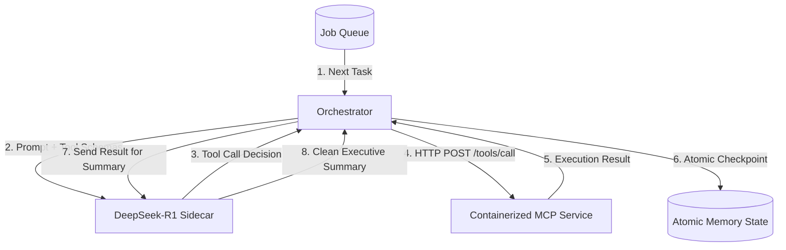

# Production Reality: Top 5 Architectural Pillars for Containerized Agent Workflows
## (বাস্তবে যা থাকা উচিত ছিল: শীর্ষ ৫টি প্রোডাকশন আর্কিটেকচার স্তম্ভ)

---

### ভূমিকা (Executive Summary)
এই ডকুমেন্টে ল্যাব ৩, ৪ এবং ৫-এর "Toy Implementation"-এর ফাঁকফোকর ও ক্রিটিক্যাল বাগগুলো দূর করে এন্টারপ্রাইজ গ্রেড **Containerized AI Agent Architecture** গড়ে তোলার জন্য শীর্ষ ৫টি মূল স্তম্ভ (Top 5 Production Reality Pillars) উপস্থাপন করা হয়েছে।

---

## 📊 সামগ্রিক তুলনামূলক সারসংক্ষেপ (Lab-by-Lab Comparison Tables)

### 📌 Lab 3: Composing the Agent Stack (Orchestrator, Tools, Memory & Queue)

| বিষয় | ল্যাবে যা আছে (Toy Implementation) | বাস্তবে যা থাকা উচিত ছিল (Production Reality) |
| :--- | :--- | :--- |
| **Nightly Job & State Scope** | পার্মানেন্ট গ্লোবাল `processed` লিস্ট; ফলে ১ম রাতের পর ২য় রাত থেকে সব কাজ আজীবনের জন্য স্কিপ হবে। | **Scoped `run_id` (তারিখ/ব্যাচ ভিত্তিক স্টেট);** প্রতি রাতের কাজের জন্য আলাদা রান নেমস্পেস বা স্টেট রিসেট পলিসি। |
| **Task Failure & Retry Handling** | টুল এরর খেলেও `ok: False` রিটার্ন করে এবং অরকেস্ট্রেটর তাকে চিরদিনের জন্য 'Done' মার্ক করে দেয়। | **Task State Machine (`pending/done/failed`);** ব্যর্থ কাজ ট্র্যাক করা, `attempts` কাউন্ট, এক্সপোনেনশিয়াল ব্যাকঅফ এবং রিট্রাই ক্যাপ (DLQ)। |
| **File Persistence & Atomicity** | সরাসরি `open(..., "w")` দিয়ে ফাইল ফাঁকা (truncate) করে রাইট করা; রাইটের সময় ক্র্যাশ হলে ফাইল পুরোপুরি করাপ্ট। | **Atomic Write Pattern;** টেম্প ফাইলে লিখে `fsync` কল করে ওএস-লেভেলে `os.replace` দিয়ে সেফলি সোয়াপ করা। |
| **Queue Import Collision** | ফাইলের নাম `queue.py`, যা পাইথনের বিল্ট-ইন `queue` মডিউলকে শ্যাডো করে `requests`/`urllib3`-কে ক্র্যাশ করায়। | ফাইলের নাম `job_queue.py` রাখা যাতে কোনো স্ট্যান্ডার্ড লাইব্রেরি নেমস্পেস কলিশন না ঘটে। |
| **Agent Intelligence & Logic** | কোনো AI বা LLM নেই; সাধারণ হার্ডকোডেড পাইথন `for/while` লুপ এবং ফিক্সড `if/else` ডিসিশন। | **Dynamic Planner / ReAct লুপ;** যেখানে পরিস্থিতি অনুযায়ী এজেন্টের ডিসিশন নেওয়ার ডায়নামিক ক্ষমতা থাকবে। |

---

### 📌 Lab 4: Packaging MCP Servers as Containerized Services

| বিষয় | ল্যাবে যা আছে (Toy Implementation) | বাস্তবে যা থাকা উচিত ছিল (Production Reality) |
| :--- | :--- | :--- |
| **Tool Protocol (MCP)** | সাধারণ কাস্টম Flask POST রিকোয়েস্ট (`POST /tools/<name>`); কোনো JSON-RPC, SSE বা স্কিমা নেই। | অফিসিয়াল **Model Context Protocol (JSON-RPC over SSE/Stdio);** `tools/list`, `tools/call` এবং টাইপড মেটাডেটা। |
| **Interface Coupling & Drift** | সার্ভারের `TOOLS` এবং ক্লায়েন্টের মেথড র‍্যাপার ডুপ্লিকেট; নতুন টুল যোগ করলে দুই জায়গায় কোড এডিট লাগে। | **Dynamic Schema Discovery (`GET /tools`);** ক্লায়েন্ট ডাইনামিকালি সার্ভারের স্কিমা রিটার্ন দেখে জেনেরিক উপায়ে যেকোনো টুল কল করবে। |
| **Crash Recovery & Save Cadence** | অপ্টিমাইজেশনের নামে শুধু লুপের শেষে স্টেট সেভ করা; মাঝপথে কনটেইনার কিল/OOM হলে সব প্রগ্রেস গায়েব। | **Save per Task (Continuous Checkpointing);** প্রতিটি টাস্ক শেষ হওয়া মাত্র ডিস্কে রাইট নিশ্চিত করা যাতে ক্র্যাশ হলেও ০% লস হয়। |
| **Container Lifecycle** | `tail -f /dev/null` দিয়ে কনটেইনার ঝুলিয়ে রেখে ম্যানুয়ালি `docker compose exec` দিয়ে চালানো। | **One-shot Worker Containers;** `docker compose run --rm agent` বা শিডিউলড ক্রন জব হিসেবে কাজ শেষে কনটেইনার গ্রেসফুলি বন্ধ হওয়া। |
| **Security & Hardening** | Flask-এর বিল্ট-ইন ডেভ সার্ভার, কোনো অথেনটিকেশন নেই, `**args` দিয়ে আনভ্যালিডেটেড কোড ইনজেকশন রিস্ক। | **Gunicorn/Waitress WSGI**, Bearer Token / API Key সিকিউরিটি, এবং Pydantic দিয়ে ইনপুট ডাটা স্যানিটাইজেশন। |

---

### 📌 Lab 5: Local Inference Sidecars (Serving DeepSeek with GPU)

| বিষয় | ল্যাবে যা আছে (Toy Implementation) | বাস্তবে যা থাকা উচিত ছিল (Production Reality) |
| :--- | :--- | :--- |
| **Model Storage & Air-gap** | এয়ার-গ্যাপডের দাবি করলেও কনটেইনার স্টার্টের সময় ইন্টারনেট থেকে প্রতিবার মডেল পুল করা হয়; কোনো ভলিউম নেই। | **Docker Named Volume (`ollama_cache`);** মডেল ক্যাশ লোকাল ভলিউমে রাখা যাতে ইন্টারনেট ছাড়াও অফলাইনে চলে। |
| **Server Healthcheck & Readiness** | `wget /api/tags` মডেল ডাউনলোড শেষ হওয়ার আগেই `200 OK` দেয়; ক্লায়েন্ট রেডি হওয়ার আগেই কল করে ফেইল খাবে। | **Model-aware Readiness Probe;** নির্দিষ্ট মডেলটি লোকাল রেজিস্ট্রি স্টোরে পুরোপুরি প্রস্তুত হলে তবেই healthy ঘোষণা করা। |
| **Reasoning & Output Handling** | DeepSeek-R1 কাঁচা `<think>` ব্লক আউটপুট দেয় এবং আনস্ট্রাকচার্ড টেক্সট রিটার্ন করে; ২ লাইনের সামারি ব্রেক করে। | **Output Parsing / Structured Outputs;** `<think>` ট্যাগ ফিল্টার করা অথবা Pydantic / JSON Schema দিয়ে ভ্যালিডেটেড আউটপুট নেওয়া। |
| **End-to-End Stack Integration** | সম্পূর্ণ বিচ্ছিন্ন টেক্সট সামারাইজার স্ক্রিপ্ট; L3-এর অরকেস্ট্রেটর বা L4-এর টুল সার্ভারের সাথে কোনো সংযোগ নেই। | **Unified Capstone Agent Loop;** অরকেস্ট্রেটর → DeepSeek সাইডকার থেকে টুল ডিসিশন নিয়ে → MCP টুল সার্ভারকে কল করবে এবং সামারি দেবে। |
| **Timeout & Streaming** | ১২০ সেকেন্ডের সিঙ্ক্রোনাস ব্লকিং কল; কোনো স্ট্রিমিং নেই, ফলে ক্লায়েন্ট প্রসেস ফ্রিজ হয়ে থাকে। | **Server-Sent Events (SSE / Streaming);** টোকেন বাই টোকেন স্ট্রিমিং ও প্রপার ক্লায়েন্ট টাইমআউট হ্যান্ডলিং। |

---

## 🏛️ Pillar 1: Atomic State Persistence & Scoped Run Lifecycle
*(অ্যাটোমিক ফাইল সেভ এবং রান-স্কোপড স্টেট ম্যানেজমেন্ট)*

### সমস্যা (The Toy Flaw):
- `state.json`-এ `open(..., "w")` ব্যবহার করায় লেখার মাঝখানে ক্র্যাশ হলে পুরো ফাইল ০ বাইট হয়ে করাপ্ট হয়ে যায়।
- `processed` লিস্টটি গ্লোবাল হওয়ায় ১ম রাতের পর ২য় রাতে ক্রন জব চালু হলে সব টাস্ক "already done" মনে করে স্কিপ করে দেয়।
- লুপের একদম শেষে একবার মাত্র স্টেট সেভ করায় মাঝপথে `kill -9` বা OOM হলে সম্পূর্ণ রানের ডেটা হারিয়ে যায়।

### প্রোডাকশন সমাধান (Production Reality):
1. **Atomic File Write:** প্রথমে একটি টেম্পোরারি ফাইলে (`.tmp`) লেখা, ডিস্কে ফ্লাশ ও `os.fsync` করা, এবং অপারেটিং সিস্টেম লেভেলে অ্যাটোমিকভাবে `os.replace` দিয়ে রিনেম করা।
2. **Scoped Run ID:** প্রতিটি রানকে `run_id` (যেমন: তারিখ বা টাইমস্ট্যাম্প `2026-10-13-nightly`) দিয়ে স্কোপ করা, যাতে প্রতি রাতের কাজ সম্পূর্ণ ফ্রেশ স্টেটে শুরু হয়।
3. **Save After Every Task:** প্রতিটি টাস্ক প্রসেস হওয়ার সাথে সাথেই ডিস্কে স্টেট সেভ করা (Checkpointing)।

```python
# memory.py (Production Reality)
import json, os, tempfile
from datetime import datetime

STATE_PATH = os.path.join("memory", "state.json")

def _save(state):
    os.makedirs(os.path.dirname(STATE_PATH), exist_ok=True)
    tmp_path = STATE_PATH + ".tmp"
    with open(tmp_path, "w") as f:
        json.dump(state, f, indent=2)
        f.flush()
        os.fsync(f.fileno())
    os.replace(tmp_path, STATE_PATH)

def init_run_state(run_id=None):
    if not run_id:
        run_id = datetime.utcnow().strftime("%Y-%m-%d")
    state = _load()
    if state.get("run_id") != run_id:
        state = {"run_id": run_id, "tasks": {}}
        _save(state)
    return state
```

---

## 🏛️ Pillar 2: Resilient Task State Machine & Queue Isolation
*(টাস্ক স্টেট মেশিন, রিট্রাই পলিসি এবং কিউ আইসোলেশন)*

### সমস্যা (The Toy Flaw):
- `queue.py` ফাইলটি পাইথনের নিজস্ব Standard Library `queue`-কে শ্যাডো (Shadow) করে `requests` / `urllib3`-কে ক্র্যাশ করিয়ে দেয়।
- টুলের এরর খেয়ে `ok: False` রিটার্ন করলেও অরকেস্ট্রেটর অন্ধের মতো টাস্কটিকে "Done" মার্ক করে দেয়, ফলে ব্যর্থ টাস্ক আর কখনো রিট্রাই হয় না।

### প্রোডাকশন সমাধান (Production Reality):
1. **Queue Isolation:** ফাইলের নাম পরিবর্তন করে `job_queue.py` রাখা যাতে কোনো নেমস্পেস কলিশন না হয়।
2. **State Machine (`pending` -> `running` -> `done` / `failed`):**
3. **Bounded Retries (MAX_ATTEMPTS):** শুধুমাত্র `result.get("ok") == True` হলেই টাস্ককে `done` বলা হবে, অন্যথায় `attempts` গণনা করে নির্ধারিত সীমা পর্যন্ত রিট্রাই করা হবে।

```python
# orchestrator.py (Production Task Loop)
MAX_ATTEMPTS = 3

for job in jobs:
    task_id = job["vendor_id"]
    task_state = state["tasks"].setdefault(task_id, {
        "status": "pending",
        "attempts": 0,
        "result": None,
        "error": None
    })

    if task_state["status"] == "done":
        continue

    if task_state["attempts"] >= MAX_ATTEMPTS:
        continue  # Move to Dead Letter Queue (DLQ)

    task_state["attempts"] += 1
    task_state["status"] = "running"
    
    try:
        result = tools.call_tool(job["kind"], vendor_id=task_id)
        if result.get("ok"):
            task_state["status"] = "done"
            task_state["result"] = result
        else:
            task_state["status"] = "failed"
            task_state["error"] = result.get("error", "Unknown tool failure")
    except Exception as e:
        task_state["status"] = "failed"
        task_state["error"] = str(e)

    memory._save(state)  # Checkpoint immediately
```

---

## 🏛️ Pillar 3: Model Context Protocol (MCP) Standard & Dynamic Tool Discovery
*(আসল MCP প্রোটোকল, ডাইনামিক স্কিমা ডিসকভারি ও সিকিউরিটি)*

### সমস্যা (The Toy Flaw):
- সাধারণ Flask POST রিকোয়েস্ট বানিয়ে তাকে "MCP" বলা হয়েছে, যেখানে কোনো JSON-RPC বা টুল স্কিমা নেই।
- সার্ভার ও ক্লায়েন্ট উভয়েই হার্ডকোডেড মেথড র‍্যাপার ডুপ্লিকেট থাকায় নতুন টুল যোগ করতে গেলে দুই জায়গায় হাত দিতে হয় (Interface Drift)।
- কোনো অথেন্টিকেশন নেই এবং আনভ্যালিডেটেড `**args` আনপ্যাকিং মারাত্মক সিকিউরিটি ভালনারেবিলিটি তৈরি করে।

### প্রোডাকশন সমাধান (Production Reality):
1. **Tool Discovery Endpoint (`GET /tools`):** সার্ভার তার কাছে থাকা সমস্ত টুলের নাম, বর্ণনা এবং JSON Schema ক্লায়েন্টকে জানায়।
2. **Generic Dynamic Dispatcher:** অরকেস্ট্রেটর কোনো হার্ডকোডেড মেথড রাখে না; সে সার্ভার থেকে স্কিমা নিয়ে ডায়নামিকালি `tools.call_tool(name, **kwargs)` চালায়।
3. **Production Server & Auth:** Flask ডেভ সার্ভারের বদলে Gunicorn/Waitress এবং Bearer Token অথেন্টিকেশন ব্যবহার করা।

```python
# mcp-server/server.py (Schema Discovery + Auth)
TOOL_REGISTRY = {
    "fetch_vendor_status": {
        "fn": tools_impl.fetch_vendor_status,
        "schema": {
            "type": "object",
            "properties": {"vendor_id": {"type": "string"}},
            "required": ["vendor_id"]
        }
    }
}

@app.route("/tools", methods=["GET"])
def list_tools():
    return jsonify({
        name: {"schema": meta["schema"]} for name, meta in TOOL_REGISTRY.items()
    })
```

---

## 🏛️ Pillar 4: Production Container Lifecycle & Persistent Model Cache
*(সঠিক কনটেইনার লাইফসাইকেল এবং মডেল ভলিউম পারসিস্টেন্স)*

### সমস্যা (The Toy Flaw):
- কনটেইনার চালু রাখতে `tail -f /dev/null` ব্যবহার করা হয়েছে, যা ডকারের চরম অ্যান্টি-প্যাটার্ন।
- এয়ার-গ্যাপড দাবি করা সত্ত্বেও প্রতিবার কনটেইনার চালুর সময় ইন্টারনেট থেকে গিগাবাইট মডেল পুল করা হয় এবং কোনো Docker Named Volume নেই।
- হেলথচেক `wget /api/tags` মডেল ডাউনলোড শেষ হওয়ার আগেই `200 OK` দেয়।

### প্রোডাকশন সমাধান (Production Reality):
1. **Named Volume for Model Weights:** `ollama_data:/home/ollama/.ollama` মাউন্ট করা, যাতে একবার মডেল ডাউনলোড হলে কনটেইনার ধ্বংস হলেও মডেল ক্যাশে থেকে যায় এবং অফলাইনে চলে।
2. **Model-aware Readiness Probe:** হেলথচেক স্ক্রিপ্ট যাচাই করবে কাঙ্ক্ষিত মডেলটি (`deepseek-r1:1.5b`) লিস্টে এসেছে কিনা।
3. **One-shot Worker Containers:** `docker compose run --rm agent` দিয়ে ক্রন শিডিউলারের মাধ্যমে রান করা।

```yaml
# docker-compose.yml (Production Reality)
services:
  inference-server:
    image: ollama/ollama:0.5.7
    deploy:
      resources:
        reservations:
          devices:
            - driver: nvidia
              count: all
              capabilities: [gpu]
    volumes:
      - ollama_models:/root/.ollama
    healthcheck:
      test: ["CMD-SHELL", "ollama list | grep -q 'deepseek-r1:1.5b' || exit 1"]
      interval: 10s
      timeout: 5s
      retries: 20
      start_period: 30s

volumes:
  ollama_models:
```

---

## 🏛️ Pillar 5: Unified Agentic Capstone Integration
*(অরকেস্ট্রেটর, টুল সার্ভিস এবং লোকাল LLM-এর সমন্বিত এজেন্ট লুপ)*

### সমস্যা (The Toy Flaw):
- ল্যাব ৩, ৪ এবং ৫ সম্পূর্ণ আলাদা। কোনো ল্যাবেই LLM অরকেস্ট্রেটরের অংশ হিসেবে কাজ করে না। ল্যাব ৫-এ শুধু একটি বিচ্ছিন্ন টেক্সট সামারাইজার তৈরি করা হয়েছে।

### প্রোডাকশন সমাধান (Production Reality):
একটি সম্পূর্ণ **Capstone Agent Loop**, যেখানে:
1. অরকেস্ট্রেটর কিউ থেকে টাস্ক গ্রহণ করে।
2. অরকেস্ট্রেটর লোকাল DeepSeek সাইডকারকে টুল স্কিমা পাঠিয়ে রিজনিং করতে বলে।
3. DeepSeek `<think>` করে ডিসিশন নেয় এবং উপযুক্ত টুল সিলেক্ট করে।
4. অরকেস্ট্রেটর সেই অনুযায়ী MCP টুল সার্ভিস কল করে এবং অ্যাটোমিকালি স্টেট চেকপয়েন্ট করে।
5. DeepSeek ফলাফল পর্যালোচনা করে চূড়ান্ত এক্সিকিউটিভ রিপোর্ট তৈরি করে।



---

### উপসংহার
এই ৫টি পিলার প্রয়োগ করলে সিস্টেমটি খেলনা প্রজেক্ট (Toy Script) থেকে একটি নির্ভরযোগ্য, ফল্ট-টলারেন্ট, এয়ার-গ্যাপড এবং সত্যিকারের **Autonomous AI Agent Platform**-এ পরিণত হয়।
